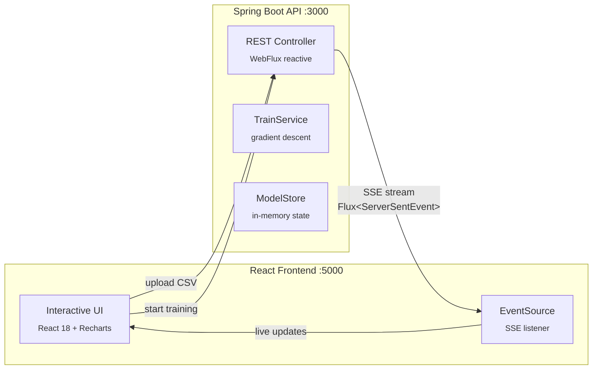

# ft_linear_regression — Streaming Gradient Descent

Linear regression trainer with **real-time visualization** — the server streams each gradient descent iteration via **Server-Sent Events (SSE)** and the frontend draws the regression line as it converges.

## Architecture



## Features

- **Streaming training** — each gradient descent step is pushed via SSE, so you watch the model learn in real-time
- **Z-score normalization** — features are normalized before training and denormalized when returning results
- **Configurable hyperparameters** — learning rate and iteration count adjustable via API
- **CSV data upload** — load and update training data at runtime
- **Precision metrics** — RMSE (Root Mean Square Error) evaluation
- **Prediction endpoint** — query the trained model for new inputs

## API Endpoints

| Endpoint | Method | Description |
|---|---|---|
| `/api/linear-regression/data-train` | GET | Get current training data |
| `/api/linear-regression/update-data-train` | POST | Upload CSV dataset |
| `/api/linear-regression/train` | GET | **SSE stream** — start training, receive each iteration |
| `/api/linear-regression/update-learning-rate` | POST | Set learning rate |
| `/api/linear-regression/update-iterations` | POST | Set iteration count |
| `/api/linear-regression/rect` | GET | Get current regression line (θ₀, θ₁) |
| `/api/linear-regression/predict` | GET | Predict value for input |
| `/api/linear-regression/precision` | GET | Get RMSE metric |
| `/api/linear-regression/config` | GET | Get current hyperparameters |

## How It Works

1. **Upload** a CSV file with (x, y) data points
2. **Configure** learning rate and iterations
3. **Start training** — the backend runs gradient descent and streams each step:
   - Normalize features with z-score (mean, standard deviation)
   - Compute MSE gradient for θ₀ and θ₁
   - Update weights and emit current state via `Flux.scan()`
   - Denormalize the final regression line
4. **Watch** the regression line converge on the chart in real-time
5. **Predict** new values using the trained model

## Tech Stack

| Layer | Technology |
|---|---|
| Language | Java 21 |
| Framework | Spring Boot 4.0.1, WebFlux (reactive) |
| Streaming | Server-Sent Events via `Flux<ServerSentEvent>` |
| Frontend | React 18, Vite, Tailwind CSS, Recharts |
| Math | Custom z-score normalization, MSE gradient |
| Containers | Docker Compose (2 services, multi-stage eclipse-temurin:21) |

## Getting Started

### Docker Compose

```bash
docker compose up -d
```

Frontend at `http://localhost:5000`, API at `http://localhost:3000`.

### Local development

```bash
# Backend
cd linear-regression && ./mvnw spring-boot:run

# Frontend
cd linear-regression-web && npm install && npm run dev
```

## Skills Demonstrated

- Reactive programming with Project Reactor (Flux, Mono, scan)
- Server-Sent Events for real-time streaming
- Gradient descent implementation from scratch
- Feature normalization (z-score)
- Spring Boot WebFlux
- Docker multi-stage builds

## License

MIT
